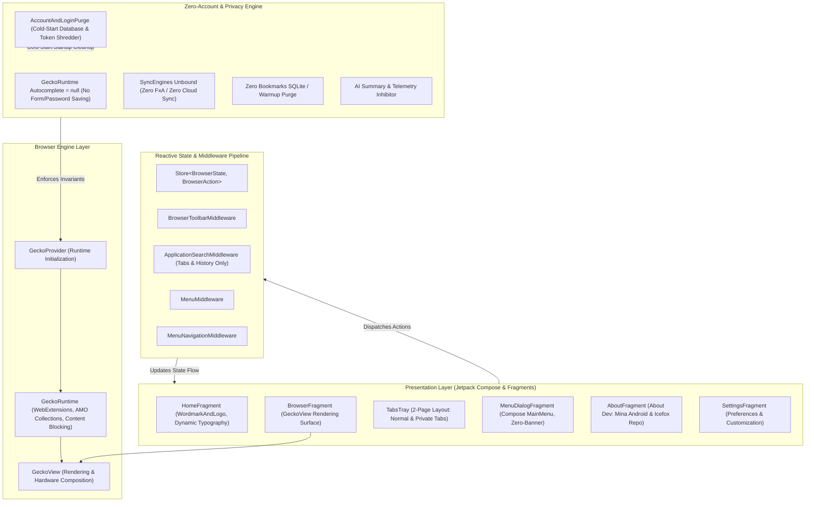
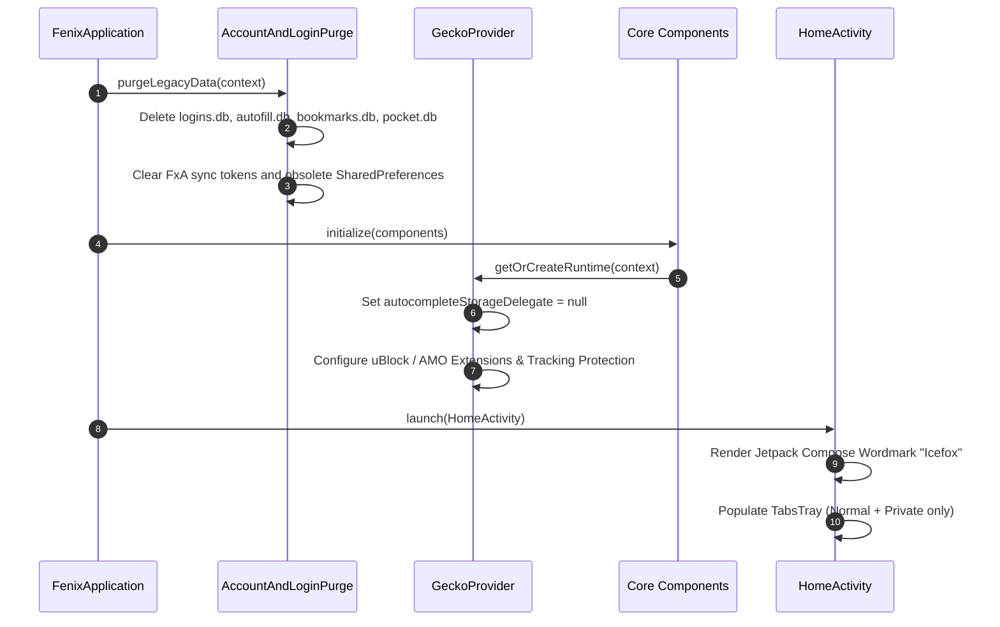

# Icefox System Architecture & Technical Design

This document details the architectural blueprint, data flow pipelines, privacy isolation guarantees, and component breakdown of **Icefox Browser**.

---

## 1. High-Level System Architecture

Icefox is an offline-first, zero-account Android web browser. It is built upon Mozilla's GeckoView web rendering engine and Android Components (`mozac`), paired with a reactive Redux state pipeline and Jetpack Compose Material 3 presentation layer.



---

## 2. Layer-by-Layer Breakdown

### 2.1 Engine Layer (`org.mozilla.fenix.gecko`)
- **`GeckoProvider`**: Singleton orchestrator that configures and boots the `GeckoRuntime`. In Icefox, `GeckoProvider` is strictly decoupled from cloud authentication and synchronization:
  - `runtime.autocompleteStorageDelegate` is assigned `null`, permanently disallowing GeckoView from capturing, remembering, or filling website passwords, credit cards, or address forms.
  - Tracking protection, WebExtension collections, and custom add-on loading are configured with strict offline privacy defaults.
- **GeckoView Omni**: Compiled against GeckoView omni binary (`158.0.2`), retaining full multi-process web standards, modern WebAssembly, CSS Grid/Flexbox, and hardware video acceleration.

### 2.2 Privacy & Zero-Trace Layer (`org.mozilla.fenix.components`)
- **`AccountAndLoginPurge`**: Executes immediately upon `FenixApplication.onCreate()` to verify system hygiene:
  - Scans and deletes obsolete SQLite database files: `logins.db`, `autofill.db`, `remote_tabs.db`, `pocket.db`, `bookmarks.db`, and `sync_tokens.db`.
  - Removes lingering SharedPreferences keys associated with Mozilla Account constellation, FxA auth tokens, and default browser banners.
- **Sync Engine Decoupling**: All synchronization engines (`SyncEngine.History`, `SyncEngine.Bookmarks`, `SyncEngine.Passwords`, `SyncEngine.Tabs`, `SyncEngine.CreditCards`, `SyncEngine.Addresses`) are permanently unbound from `GlobalSyncableStoreProvider`.

### 2.3 Presentation Layer (`org.mozilla.fenix.home`, `org.mozilla.fenix.browser`)
- **`WordmarkAndLogo.kt`**: Built with Jetpack Compose Material 3 typography (`MaterialTheme.typography.headlineMedium`) and high-contrast dynamic on-surface coloring. Replaces legacy bitmap wordmarks with crisp, scalable typography.
- **`TabsTray.kt`**: Fixed to a 2-page or 3-page configuration (Normal Tabs, Private Tabs, and optional Tab Groups). The `Page.SyncedTabs` tab page and header indicator are permanently removed.
- **`MenuDialogFragment.kt`**: Compose-based popup menu. The default browser banner card (`showBanner`) is hardcoded to `false` and `shouldShowMenuBanner` returns `false`.
- **`AboutFragment.kt`**: Contains direct developer attribution to **Mina Android** (linking to portfolio `https://portfolio.minaashraf285.workers.dev/`) and link to the source repository **Icefox** (`https://github.com/mina-android/Icefox`).
- **Adaptive App Icon & Launcher Hygiene**: Configured custom Icefox adaptive icon (`app_icon.png` at 60% canvas safe ratio) and Android 12+ Material Themed Icon (`themed_icon.png`). "App icon" / "Select App Icon" preference category in `customization_preferences.xml` and obsolete `activity-alias` entries in `AndroidManifest.xml` have been excised.

### 2.4 State & Middleware Pipeline (`org.mozilla.fenix.search`, `org.mozilla.fenix.components.search`)
- **`ApplicationSearchMiddleware`**: Registers shortcuts for quick filtering. Bookmarks search shortcut (`BOOKMARKS_SEARCH_ENGINE_ID`) is completely removed from the shortcut engine list, leaving exclusively Open Tabs and History.
- **`BrowserToolbarSearchMiddleware`**: Manages URL bar actions. Voice search / speech recognition microphone actions are permanently disabled (`shouldShowVoiceSearch: Boolean get() = false`).

---

## 3. Directory Layout

```
IceRaven/
├── app/
│   ├── src/
│   │   ├── main/
│   │   │   ├── java/org/mozilla/fenix/
│   │   │   │   ├── bookmarks/             # Legacy bookmarks wrappers (excised/inert)
│   │   │   │   ├── browser/               # BaseBrowserFragment, GeckoView session binding
│   │   │   │   ├── components/            # AccountAndLoginPurge, Core, BackgroundServices
│   │   │   │   ├── gecko/                 # GeckoProvider runtime configuration
│   │   │   │   ├── home/                  # Homepage, WordmarkAndLogo, SessionControl
│   │   │   │   ├── search/                # Search middlewares and toolbar actions
│   │   │   │   ├── settings/              # AboutFragment, Customization, SearchEngineFragment
│   │   │   │   ├── tabstray/              # 2-Page TabsTray layout (Normal & Private)
│   │   │   │   └── utils/                 # Settings.kt (centralized feature flags)
│   │   │   ├── res/                       # XML layouts, preferences, strings, icons
│   │   │   └── AndroidManifest.xml        # Application package: com.ma.icefox
│   │   ├── forkDebug/                     # Debug configurations & test manifests
│   │   └── forkRelease/                   # Release configurations & metadata
│   └── build.gradle                       # Versioning: 1.0.1, applicationId: com.ma.icefox
├── gradle/                                # Gradle wrapper and build cache configuration
├── AGENTS.md                              # AI Agent rules & mandatory file sync instructions
├── AI_INSTRUCTIONS.md                     # Condensed rules-first guidelines & toolchain stack
├── CHANGELOG.md                           # Version release notes and migration history
├── CLAUDE.md                              # Developer & Claude reference manual
├── README.md                              # Project overview, badges, features, and quick links
├── STRUCTURE.md                           # System architecture and data flow blueprint
└── version.txt                            # Upstream GeckoView binary anchor (158.0.2)
```

---

## 4. Cold-Start Initialization Lifecycle


